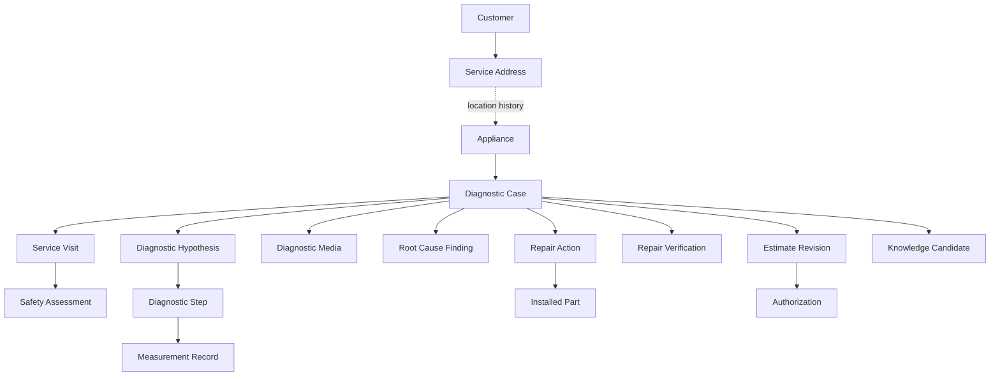

# HADS Phase 1 项目需求规格说明书（PRD）
**版本**：1.1 Engineering Baseline（待审批）｜**日期**：2026-10-07｜**产品**：HUGO’S Appliance Diagnostic System

## 1. 产品愿景与目标
为 HUGO’S APPLIANCE REPAIR 的现场家电维修建立桌面与移动端功能对等、现场离线可用、证据可追溯的专业诊断与维修闭环。不是通用派工/ERP。系统将实际技术判断（假设、测试、期望、实测、解释、决策）与维修动作、复测结果、设备历史串成可审计记录，并支持从已审核案例提炼知识。

### 1.1 可衡量成功指标（建议验收目标，需实测）
- 真实维修场景能在电脑及手机分别独立完成设备识别→安全评估→诊断→维修→验证→归档；不依赖桌面端。
- 断网可录入全部 P0 现场证据；重新联网不丢失、不重复创建，冲突可解释。
- 每个确认的根因可追溯到诊断假设与至少一个支持性证据，允许记录“无法确认”。
- 维修完成状态必须有验证结果；未验证可作为不同的关闭结局，不可伪称修复成功。
- 核心异常场景通过 `qa/Acceptance_Test_Cases.md`。

## 2. 角色与权限
| 角色 | 可执行操作 | 禁止事项 |
|---|---|---|
| Technician | 创建/更新本人授权案件、检查、诊断、维修、上传证据 | 伪造历史、绕过安全门禁、篡改他人已签授权 |
| Lead Technician / Reviewer | 复核根因、维修结果、审核知识候选、处理例外 | 删除审计记录 |
| Admin | 用户权限、设备资料配置、保留政策、纠错审批 | 直接改写历史证据 |
| Customer（一期无登录） | 现场确认诊断收费、报价、完工确认 | 访问内部技术记录 |

一期可单技术员部署，但权限模型不能直接硬编码为超级管理员。

## 3. 范围
### 3.1 P0 必须交付
M01 设备识别与历史；M02 Case/Visit 维修案件；M03 动态安全门禁；M04 假设驱动诊断；M05 测量与媒体证据；M06 维修动作与零件使用；M07 维修后验证与结案；M08 离线记录与同步；M09 历史案例检索（基本条件）；M10 技术知识候选（人工审核，不自动建议危险操作）。

### 3.2 P1 仅限维修闭环
客户/地址快照；报价版本和分阶段授权；简易费用与收款记录；PDF/打印报告；基础用户权限；工具/仪表溯源（可选字段）；基本保修关联。

### 3.3 明确排除
高级派工与路线优化、复杂仓储/采购、会计总账与税务申报、商业 BI、预测性 AI、OEM 自动爬取、完整知识图谱、翻新生产线、多租户 SaaS、客户自助门户。后续阶段独立评估。

## 4. 核心领域模型

客户和地址不是设备永久所有权；设备可以移动，历史关系和案件现场快照不得因地址更新而改变。一个 Case 可有多个 Visit、假设、报价版本、授权、维修动作、验证、保修。

## 5. 端到端业务流程
1. 新建/匹配设备（品牌、型号、序列号、铭牌照片、识别可信度）；防止误合并同型号设备。
2. 创建 Case：症状、发生条件、错误码、历史、设备现场快照；允许信息未知。
3. 预约信息非必要；实际到场建立 Visit；记录开始/结束与技师。
4. 每次作业按任务风险检查断电/上电、储能、旋转部件、制冷剂、热表面、漏水等；风险不受控则 STOP_WORK。
5. 建立多个可证伪 Hypothesis，按优先级记录 Test / Expected / Actual / Interpretation / Next Step；否定假设后返回诊断。
6. 测量记录支持 NUMERIC / OL / UNSTABLE / NOT_MEASURED / ABORTED，单位、量程、仪表、时间、条件与附件。
7. 根因结论支持 CONFIRMED / PROBABLE / UNDETERMINED，支持证据引用和相反证据；不允许自动把猜测标为已确认。
8. 报价与客户授权采用**版本快照**，诊断收费、维修范围、完工确认分开；拒绝签字可记录拒绝与替代确认方式，不能伪造签名。
9. 维修动作：部件、拆装/清洗/调整/更换、旧件与新件、关键参数、异常（DOA、装机损坏）、作业人。
10. 修后验证：按设备/修理类型检查安全、目标功能、泄漏/电流/温度/循环等，PASS/FAIL/NA/NOT_COMPLETED；失败回诊断或待件。
11. 结案：FIXED_VERIFIED、UNRESOLVED、CUSTOMER_DECLINED、BER、UNSAFE、NO_FAULT_FOUND、REFERRED、CANCELLED；与工作流状态分离。
12. 人工审阅候选知识，保存来源与反例，不覆盖原始测量。

## 6. 状态机（服务端强制校验）
### 6.1 Case workflow
`OPEN → DIAGNOSING → PENDING_AUTHORIZATION → IN_REPAIR → VERIFYING → CLOSED`
允许：`DIAGNOSING → PENDING_PARTS → IN_REPAIR`、`PENDING_AUTHORIZATION → DIAGNOSING`、`IN_REPAIR → PENDING_PARTS`（DOA/缺件）、`IN_REPAIR → DIAGNOSING`（假设推翻/安装失败）、`VERIFYING → DIAGNOSING`（复测失败）、`VERIFYING → PENDING_PARTS`；各活动状态可 `ON_HOLD`（须填写原因和恢复目标）或按结案规则 `CLOSED`。`CLOSED` 默认不可重开；复诊建关联新 Case。每次变更写入 `case_state_events`。

### 6.2 Visit
`PLANNED → IN_PROGRESS → PAUSED → IN_PROGRESS → COMPLETED`，亦可 `CANCELLED`；Case 与 Visit 状态不互相替代。

### 6.3 Safety
`NOT_ASSESSED → CLEARED_STATIC / CLEARED_LIVE / STOP_WORK`；每一测试步骤声明所需安全模式，必须有该 Visit 内有效的安全评估，遇条件变化需重新评估。断电验证不能仅依赖非接触测电笔。不得把 CAT 等级一刀切，必须按测点类别与环境匹配合规仪表、培训和作业规范。

### 6.4 Hypothesis
`PROPOSED → TESTING → SUPPORTED / REFUTED / INCONCLUSIVE`；后续新证据产生新解释事件，不能抹去原判断。

### 6.5 Repair / Verification
维修动作 `PLANNED → IN_PROGRESS → COMPLETED / FAILED / ABORTED`；验证 `PENDING → PASS / FAIL / NA / NOT_COMPLETED`。不可用仅有“已更换配件”作为修复成功证明。

### 6.6 Estimate / Authorization
报价 `DRAFT → ISSUED → ACCEPTED / REJECTED / EXPIRED / SUPERSEDED`；授权绑定 `estimate_revision_id` + 内容摘要哈希 + 客户确认方式 + 时间 + 范围。新报价修订不得自动继承旧授权。现场离线签署是待同步的原始事件，服务端仍需审查有效性及冲突。

## 7. 详细功能需求（带验收标准）
| ID | 需求 | 验收条件 |
|---|---|---|
| FR-001 | 设备识别及去重提醒 | 相同序列号提示疑似重复，不强行合并；允许未知序列号 |
| FR-002 | 设备历史与位置变更 | 地址修改后历史 Case 现场地址不变化 |
| FR-003 | 一案多次上门 | 同一 Case 至少两次 Visit 可独立记录安全检查 |
| FR-004 | 风险驱动安全门禁 | 未获所需安全许可的测试请求被服务端拒绝并审计 |
| FR-005 | 假设驱动测试 | 每次测试关联假设、目标、预期、结果和决策 |
| FR-006 | 非数值测量 | OL/未测/中止不要求伪造数值 0 |
| FR-007 | 原始证据不可静默改写 | 更正产生 amendment 并保留原始值和作者 |
| FR-008 | 多媒体与哈希 | SHA-256 校验，上传失败可恢复，不重复附着 |
| FR-009 | 根因支持与反证 | 可标未确定，引用支持和反对证据 |
| FR-010 | 维修动作及异常回退 | DOA 触发待件；验证失败回诊断 |
| FR-011 | 验证模板与结果 | PASS/FAIL/NA/NOT_COMPLETED 有必需原因字段 |
| FR-012 | 报价版本化 | 修改已发报价生成新版本，不修改已签版本 |
| FR-013 | 分阶段授权 | 未获适用授权禁止执行收费维修动作 |
| FR-014 | 离线现场记录 | 断网完成 Case/Visit/诊断/维修/验证草稿并可重试 |
| FR-015 | 幂等同步 | 同一 mutation 重放 10 次只产生一次服务器写入 |
| FR-016 | 冲突显式呈现 | 预约取消/客户信息冲突不被 LWW 静默覆盖 |
| FR-017 | 检索相似历史 | 按品牌、型号、症状、错误码、部件、根因搜索 |
| FR-018 | 知识候选审阅 | 未审核规则不得作为已验证指导发布 |
| FR-019 | 基础报告 | 可输出设备、测试、维修、验证、限制与授权摘要 |
| FR-020 | 访问控制及审计 | 未授权用户无法读取客户资料；重要状态变更可追踪 |

## 8. 非功能性要求
- **移动体验**：宽度 360px 起，戴手套/现场操作适用的大触控区域；重要步骤可单手完成；中文后台说明、英文客户报告可配置。
- **可用性**：离线应用壳预缓存；刷新后草稿保留；无后台同步时打开 App/前台触发同步；明确显示“本地保存/待同步/已确认/冲突”。
- **一致性**：服务端数据库事务、乐观锁 `row_version`、客户端 UUID、`Idempotency-Key`；不可用设备本地时间判定谁获胜。
- **性能目标（验收预算）**：常见设备历史 95% 查询 < 1s（在定义的测试网络和样本量下测量）；本地表单保存 95% < 200ms；大文件异步上传。
- **安全**：TLS、最小权限、认证过期处理、数据库备份加密、对象存储私有访问、敏感信息脱敏、操作审计；按实际业务适用法律审查隐私/保存政策。
- **可靠性**：断电/强杀 App/重复请求/网络抖动不丢已确认的本地提交；需验证移动 OS 清理浏览器存储的风险并提示导出/同步。
- **可维护性**：单体模块化、迁移脚本、结构化日志、自动化测试、API 契约版本化。
- **安全声明**：软件不是安全培训或法定合规认证的替代；危险测试只能由有资格人员依适用规范执行。

## 9. 数据留存与合规边界
诊断证据、签名、付款凭证保留期限须由实际法律/保险/商业政策确认。业务删除默认逻辑停用；访问权与保留期限分开。支持按合法请求导出、更正、限制访问；对确需删除的数据制定受控销毁程序。未经审批不做永久不可删除承诺。

## 10. 验收与发布门槛
全部 P0 验收用例通过；离线重放、并发冲突、安全门禁、签名版本、DOA 回退、失败验证、数据库恢复演练通过；产品负责人用至少 3 类真实设备场景现场走通并签署 UAT；无高危安全/隐私缺陷；部署/回滚/备份说明齐备。

## 11. 变更控制
PRD 冻结后新功能进入 backlog；任何 P0 改动需同步修改状态机、API、DDL、测试；重大架构变更记录 ADR。

## 11. 跨终端完整业务能力（v1.1 新增，P0）
**FR-UI-001**：电脑端（Desktop Web）与手机端（Mobile Web/PWA）必须均可独立完成设备查询/建档、Case 创建、Visit、安全检查、诊断假设、测试/测量、照片上传、维修动作、修后验证、报告查看、知识检索。禁止将任一端降级为只读。

**FR-UI-002**：共用统一 Spring Boot REST API、鉴权、领域规则、PostgreSQL 主数据；不建设两套独立业务后端。

**FR-UI-003**：桌面采用多栏工作台（设备与案件导航、假设/步骤、测量/证据），支持键盘焦点、快捷录入、表格筛选、分页、打印；手机采用单列分步操作、大触控目标、相机采集、网络状态提示。

**FR-UI-004**：两端均支持创建、查看、修改未锁定的业务数据；已提交证据只允许更正事件，不允许覆盖原件。支持从电脑录入、手机继续操作及反向切换。

**FR-UI-005**：手机端现场离线为必须；桌面端在浏览器允许的环境下支持相同离线草稿/Outbox 能力，但不承诺所有浏览器、隐私模式或存储受限环境永久保存。显示未同步数量与持久化风险。

**FR-UI-006**：同一案件跨设备并发修改必须采用服务端版本号/ETag 与 If-Match（或等价 revision 校验）；返回 409/412 冲突及服务端当前版本，禁止静默覆盖。证据 append-only、状态机服务端校验、签名授权不得 LWW。

**FR-UI-007**：电脑端至少覆盖 1280px 常见宽屏布局，手机端至少覆盖 360px 视口；具体浏览器支持矩阵见 `docs/07_Cross_Device_UI_UX_Spec.md`。

### 11.1 跨设备业务验收
- AC-XD-01：仅用桌面浏览器独立完成完整维修案例，不需要借助手机。
- AC-XD-02：仅用手机浏览器独立完成同一流程，不需要借助电脑。
- AC-XD-03：桌面创建的 Case 在手机登录后可检索并继续操作，反之亦然。
- AC-XD-04：手机离线新增测量，电脑在线更新同一 Case 状态；重连后测量保留、冲突明确展示，不回滚服务器状态。
- AC-XD-05：桌面与手机同时编辑同一可变字段，后提交者收到可恢复冲突提示。
- AC-XD-06：桌面端可通过键盘完成主要诊断表单；移动端表单无横向滚动、拍照后可预览。
- AC-XD-07：两端对未授权维修、STOP_WORK、安全模式不符的步骤均被后端拒绝。

### 11.2 数据与隐私
桌面、手机共享相同权限和审计日志。服务端记录 actor、device/session、mutation_id、record_revision、时间戳；不得以 User-Agent 作为权限判据。设备丢失/共享电脑登出时应清理本地敏感缓存；不承诺浏览器本地数据具有硬件级加密。
